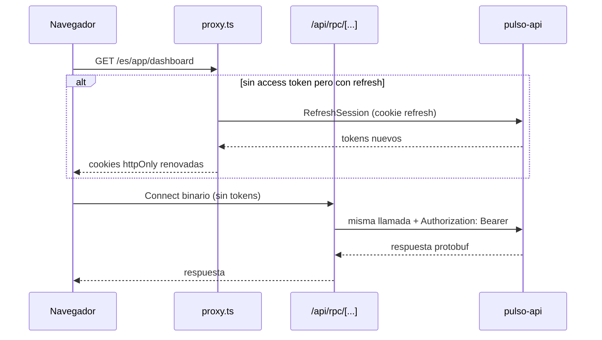
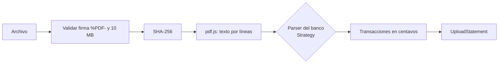

# pulso-web

Frontend de **Pulso**, construido con Next.js 16 (App Router), React 19 y Tailwind CSS 4. Lee el extracto bancario en PDF **dentro del navegador con un Web Worker**, envía solo las transacciones y muestra en vivo el análisis: dashboard con gráficos, anomalías explicadas, gastos hormiga, pagos recurrentes, liquidez proyectada y recomendaciones.

| Repositorio | Rol |
| --- | --- |
| **pulso-web** | Este repositorio: interfaz, lectura del PDF y BFF |
| [pulso-api](https://github.com/Jack-Limas/pulso-api) | Backend, sesión y tiempo real; su README tiene la arquitectura completa |
| [pulso-ai](https://github.com/Jack-Limas/pulso-ai) | Motor de análisis e IA |

Producción: <https://pulso-web-ashen-sigma.vercel.app>

---

## Patrones de rendering

Cada página usa el patrón que corresponde a sus datos. Se usa el modelo clásico de Next (`generateStaticParams`, `revalidate`, `force-dynamic`), así cada decisión queda explícita en el código.

| Página | Patrón | Por qué |
| --- | --- | --- |
| `/[locale]` (landing) | **SSG** | Igual para todos; se genera al compilar en español e inglés |
| `/[locale]/login`, `/register` | **SSG** con isla cliente | El formulario es interactivo, pero la página no depende del usuario |
| `/[locale]/banks` | **ISR** (`revalidate = 3600`) | El catálogo cambia poco; se regenera en segundo plano sin volver a desplegar |
| `/[locale]/app/dashboard`, `/admin` | **SSR** (`force-dynamic`) | Datos privados del usuario, frescos en cada petición |
| `/[locale]/app/upload`, `/transactions` | **CSR** dentro de una página SSR | Web Worker, `File`, `requestAnimationFrame` y filtros en vivo solo existen en el navegador |
| Escena 3D del landing | **CSR** (`dynamic(..., { ssr: false })`) | WebGL solo existe en el navegador; la página sigue siendo estática |

`next build` lo confirma en su tabla de rutas: ● para SSG/ISR y ƒ para SSR.

---

## BFF: Backend for Frontend

El navegador **nunca habla con la API ni toca los tokens**. Todo pasa por el servidor de Next, en el mismo dominio.



**Por qué existe:** Vercel y Render están en dominios distintos. Los navegadores bloquean cada vez más las cookies de terceros, y el servidor de Next no podría hacer SSR del dashboard con una cookie que pertenece a otro dominio.

| Pieza | Responsabilidad |
| --- | --- |
| `src/proxy.ts` | Redirige a un idioma, protege `/app` y renueva la sesión **antes** de renderizar. La página ve el token nuevo en la misma petición |
| `app/api/auth/*` | Login, registro y logout. Aceptan JSON del formulario hidratado y también **POST de formulario normal**: las credenciales nunca terminan en la URL, aunque JavaScript no haya cargado |
| `app/api/rpc/[...procedure]` | Reenvía solo procedimientos permitidos, agrega el token y, si recibe 401, renueva la sesión y reintenta una vez |
| `app/api/auth/socket-token` | Entrega el access token de corta vida para el primer mensaje del WebSocket; el refresh token nunca sale de su cookie |
| `lib/api/server.ts` | Clientes Connect para el servidor: privados sin caché, catálogo público con caché para ISR |

Cookies: `pulso_access` (expira 30 s antes que el JWT) y `pulso_refresh` (30 días), ambas `httpOnly`, `SameSite=Lax` y `Secure` en producción.

---

## Lectura del PDF en un Web Worker



- `lib/statements/pipeline.ts` es el mismo código en los dos modos. `run.ts` lo ejecuta en un **Web Worker** (`workers/statement.worker.ts`, con el `ArrayBuffer` transferido, no copiado) o en el **hilo principal**, para poder compararlos.
- pdf.js recibe su propio código de worker en `globalThis.pdfjsWorker`, así procesa en el hilo donde se le llama y la comparación mide el mismo trabajo.
- **Strategy:** `parsers/` tiene un parser por banco con `matches()` y `parse()`. Soportar un banco nuevo es agregar un archivo. Los montos se convierten a centavos `bigint` desde el texto, sin pasar por flotantes.
- Errores con código propio: `NOT_A_PDF`, `TOO_LARGE`, `UNREADABLE`, `UNSUPPORTED_BANK`, `MISSING_HEADER` y `NO_TRANSACTIONS`. También se rechaza un extracto de un banco distinto al de la cuenta.

### Métricas y la comparación Worker vs hilo principal

| Métrica | Cómo se mide |
| --- | --- |
| Tiempo de carga del PDF | `performance.now()` alrededor de `file.arrayBuffer()` |
| Tiempo de procesamiento | Dentro del pipeline; se guarda en la API por modo |
| Respuesta de la API | Duración de `UploadStatement` |
| **Mayor bloqueo de la interfaz** | La mayor brecha entre dos `requestAnimationFrame` mientras se procesa |
| INP | Librería `web-vitals` |
| Memoria | `performance.memory` (solo Chromium; si no existe se muestra "—") |

El indicador animado de la pantalla de carga se mueve con **JavaScript**, no con CSS. Las animaciones CSS corren en el hilo del compositor y siguen moviéndose aunque el hilo principal esté bloqueado; una animación por `requestAnimationFrame` se congela de verdad. Así se ve a simple vista la diferencia con `carga-pesada-2026-10.pdf` (2.001 transacciones).

---

## Tiempo real, idiomas y tema

- `lib/realtime/realtime-provider.tsx` abre **un WebSocket por pestaña**, se autentica con el primer mensaje y se reconecta con **backoff exponencial con jitter**. Los componentes se suscriben con `useRealtime()`.
- La pantalla de carga sigue cada etapa del análisis. Guarda los eventos que llegan antes de conocer el ID del extracto, así no se pierde ninguno.
- Cuando un análisis termina, el dashboard SSR se actualiza con `router.refresh()`. Los anuncios del admin aparecen como avisos.
- Idiomas: `/es` y `/en`, con diccionarios tipados. Si falta una traducción, TypeScript no compila.
- Tema claro por defecto y oscuro con botón. Un script en `<head>` aplica la preferencia **antes del primer pintado** para evitar el destello.

---

## Contratos que consume

`proto/pulso/v1` es una copia de los contratos de `pulso-api`, documentados en su README: `AuthService` (solo `GetCurrentUser` desde el navegador), `BankAccountService`, `StatementService`, `InsightsService` y `AdminService`. El código se genera con `npm run generate`. Si `pulso-api` cambia un contrato, esta copia se actualiza en el mismo cambio.

---

## Ejecutar en local

Requisitos: Node 22 y el backend corriendo (por ejemplo, la demo Docker de `pulso-api` en el puerto 8080).

```bash
cp .env.example .env.local
npm install
npm run dev
```

| Variable | Descripción |
| --- | --- |
| `API_URL` | URL de `pulso-api`; solo la usa el servidor de Next |
| `NEXT_PUBLIC_WS_URL` | URL del WebSocket (`wss://…/ws` en producción) |

### Pruebas

```bash
npm test            # parsers y montos (Vitest)
npm run typecheck
npm run lint
```

### Pruebas end to end (Playwright)

Corren contra un backend real: login, registro, sesión, idioma y tema, carga en Worker y en hilo principal, duplicados, banco no soportado, dashboard, edición de categorías, acceso de admin y un **anuncio que llega en vivo al navegador de otro usuario**.

```bash
npx playwright install chromium
npm run build
E2E_ADMIN_EMAIL=... E2E_ADMIN_PASSWORD=... npm run test:e2e
```

Las pruebas de admin se omiten si no se definen esas dos variables.

### Cargar las cuentas de demostración

```bash
API_URL=https://pulso-api-a.onrender.com DEMO_PASSWORD=... npm run seed:demo -- ../pulso-ai/output
```

El script usa el mismo parser del navegador. Omite los periodos que ya existen, así puede correrse varias veces.
